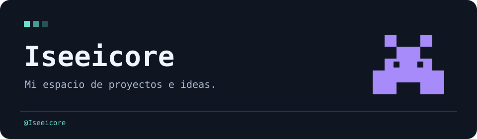

  

# Hola, soy César 👋

Este es mi espacio para compartir proyectos, ideas y lo que voy aprendiendo.

Estoy construyendo una identidad visual propia para este perfil, con ilustraciones SVG y animaciones pixel art.

## Proyectos

Próximamente compartiré aquí una selección de mis proyectos.

[Explorar mis repositorios →](https://github.com/Iseeicore?tab=repositories)

## Sobre este espacio

Un perfil en construcción, con lugar para experimentar y crear.

<!-- Añade aquí tu presentación, tecnologías y enlaces cuando los tengas definidos. -->
<!-- Imagen:  -->
<!-- SVG:  -->
<!-- Animación:  -->
