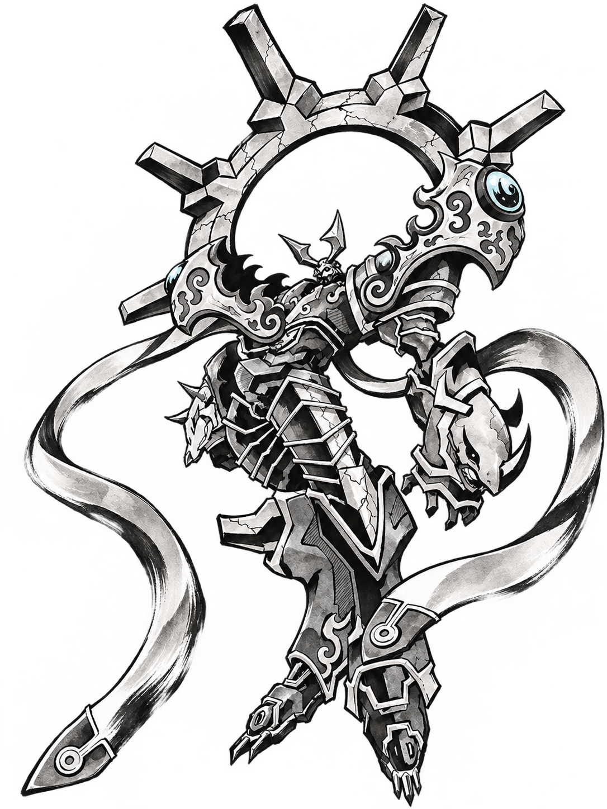

<h1 align="center">César · Iseeicore</h1>

<strong>Desarrollo web · APIs · Datos · Inteligencia artificial</strong>

<table>
  <tr>
    <td width="66%" valign="middle">
      <h2>Hola, soy César</h2>
      
Construyo aplicaciones con <strong>Python y JavaScript</strong>, conectando interfaces, APIs y bases de datos.

      
Mi stack combina <strong>Next.js</strong> y <strong>FastAPI</strong> con <strong>PostgreSQL</strong> y <strong>Redis</strong>. También trabajo con gestión de colas y procesamiento de tareas en segundo plano.

      
Este espacio reúne mi lado técnico y mi gusto por las historias, el manhwa y la ilustración.

      <a href="https://github.com/Iseeicore?tab=repositories">Explorar mis repositorios →</a>
    </td>
    <td width="34%" align="center" valign="middle">
      
    </td>
  </tr>
</table>

## Mi stack

<table>
  <tr>
    <td width="20%" align="center" valign="middle">
      
    </td>
    <td width="60%" align="center" valign="middle">
      
<strong>LENGUAJES</strong> Python · JavaScript

      
<strong>FRAMEWORKS</strong> Next.js · FastAPI

      
<strong>DATOS</strong> PostgreSQL · Redis

      
<strong>TÉCNICAS</strong> Gestión de colas Procesamiento en segundo plano

    </td>
    <td width="20%" align="center" valign="middle">
      
    </td>
  </tr>
</table>

## Proyecto estrella

<table>
  <tr>
    <td width="36%" align="center" valign="middle">
      
    </td>
    <td width="64%" valign="middle">
      
★ <strong>PROYECTO DESTACADO</strong>

      <h3>Cartillas IA</h3>
      
Mi proyecto estrella: un espacio para unir desarrollo e inteligencia artificial.

      
<a href="https://github.com/Iseeicore/modelo_cartilla"><strong>Explorar Cartillas IA →</strong></a>

    </td>
  </tr>
</table>

---

  
  &nbsp;&nbsp;&nbsp;
  

<em>Curiosidad para aprender. Imaginación para crear.</em>

<a href="https://github.com/Iseeicore">@Iseeicore</a>

