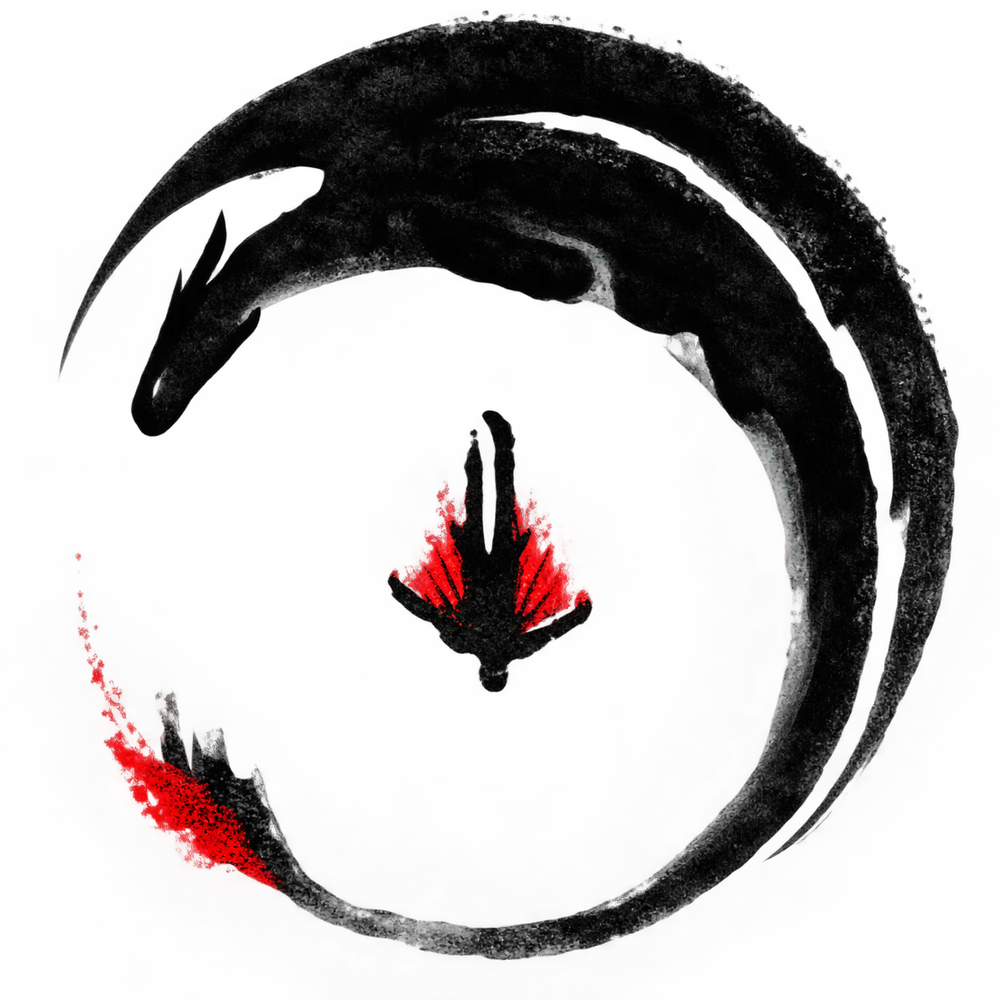

<h1 align="center">César · Iseeicore </h1>

<strong>Desarrollo web · APIs · Datos · IA</strong>

 

### Hola, soy César

Construyo aplicaciones con **Python y JavaScript**, conectando interfaces, APIs y bases de datos.

Trabajo con **Next.js, FastAPI, PostgreSQL y Redis**, además de gestión de colas y tareas en segundo plano.

Aquí conviven mi lado técnico, el manhwa y la ilustración.

[Explorar mis repositorios →](https://github.com/Iseeicore?tab=repositories)

 

---

<h2 align="center">Mi stack</h2>

Las herramientas con las que construyo

    
  &nbsp;&nbsp;&nbsp;
    
  &nbsp;&nbsp;&nbsp;
    

    
  &nbsp;&nbsp;&nbsp;
    
  &nbsp;&nbsp;&nbsp;
    

<h3 align="center">Skills</h3>

  
  &nbsp;&nbsp;
  

---

<h2 align="center">Proyecto estrella</h2>

### ✦ Cartillas IA

Mi proyecto destacado, donde desarrollo e inteligencia artificial se encuentran.

 

---

  
  &nbsp;&nbsp;&nbsp;
  

<em>Curiosidad para aprender. Imaginación para crear.</em>

<a href="https://github.com/Iseeicore">@Iseeicore</a>

